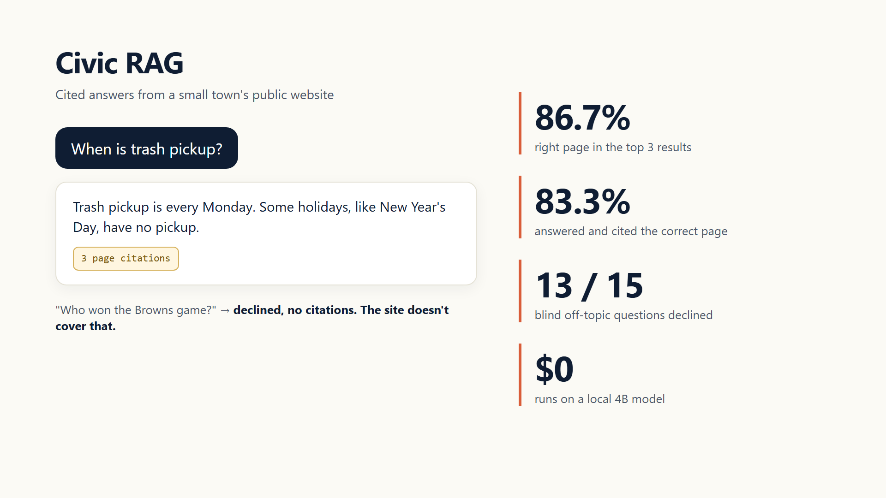

# civic-rag


A small, local-first RAG assistant that answers resident questions from a municipality's public website and attaches page citations.



## Results

Real run on a small Ohio village's 54-page public website, on a local `qwen3:4b` model through Ollama, so it costs $0 to run. Every miss is listed in [eval/RESULTS.md](eval/RESULTS.md).

| What was measured | Result |
| --- | ---: |
| Right page in the top 3 search results | **86.7%** (26/30) |
| Answered and cited the correct page | **83.3%** (25/30) |
| Off-topic questions declined, blind set written by a separate agent | **13/15** |
| Said "I can't find that" when the site did have it | 1/30 |
| Median answer time on a local 4B model | 9.3s |
| Model cost | $0 |

**What I fixed before trusting these numbers.** The first eval said 100% grounded and 6/6 refusals. Both were fake. Every answer had citations attached whether or not the model actually found the answer, and the off-topic filter listed the exact cities from my test questions. Now a citation only ships when the model actually answers, the filter only blocks personal medical or legal advice, and everything else off-topic has to be caught by the model saying the site doesn't cover it. Then I tested that on 15 questions written by an agent that never saw the code.

The two blind misses were getting a birth certificate and finding your polling place. The model answered both from the closest page instead of declining. A village site can partly cover those by pointing people to the county, but I counted them as misses anyway.

## How it works

- Crawl a public website into a local JSON corpus with `ingest.py`.
- Split pages into overlapping, paragraph-aware chunks.
- Search with BM25 over the page title and chunk text.
- Keep only one chunk per page in the retrieved set so long pages do not crowd out the result list.
- Send the retrieved passages to Ollama, Anthropic, or Gemini and return the answer with structured page citations.
- Scrub common personal information before writing the optional local conversation log.

## Guardrails

- The model is instructed to use only retrieved website text.
- Every answer includes one to three page citations. A non-answer gets none, so it cannot pass as grounded.
- Personal medical or legal advice is declined before retrieval. Anything else the site does not cover has to be caught by the model saying so, and then no citations are attached.
- The prompt declines legal, financial, medical, eligibility, and permit determinations.
- The HTTP endpoint has per-IP burst and hourly rate limits.
- Conversation logs default outside the checkout, in the user-local application data directory.

## Why BM25

This corpus is only 54 pages. BM25 is zero-cost, easy to inspect, and gives a useful page-level score without a vector database or embedding API. The tradeoff is vocabulary mismatch: a resident can ask with different words than the website uses. The results make that visible, especially at recall@1.

## Where it misses and what I'd do next

BM25 matches words, so it struggles when a resident asks in different words than the site uses: "help for older residents" vs a page titled for seniors, or "job openings" vs an employment page. Right page ranked first is only 53.3%. Next I'd add synonym expansion, hand-curated aliases on page titles, and a small reranker, then re-run this exact eval before claiming an improvement.

## Run it

Requires Python 3.11+ and no packages beyond the standard library.

```powershell
# Build a corpus for a site you are allowed to crawl.
python ingest.py https://your-municipality.example

# Ollama is the local default. Start the server, then open http://localhost:8787.
$env:LLM_PROVIDER = "ollama"
python assistant.py --serve

# Or configure Anthropic or Gemini in your shell environment.
# Copy config.example.json to config.json only if you want local contact details.

# Run the evaluation against a corpus you have locally.
python eval/run_eval.py --corpus corpus/pages.json

# Run the stdlib test suite.
python -m unittest discover -v
```

Provider settings are documented in [.env.example](.env.example). Do not commit `config.json`, `.env`, generated corpora, or conversation logs.

## Layout

- `assistant.py` — BM25 retrieval, provider adapters, PII scrub, rate-limited HTTP server
- `ingest.py` — public-site crawler and chunker
- `eval/` — fixed question set, runner, and measured results
- `tests/` — stdlib unit tests
